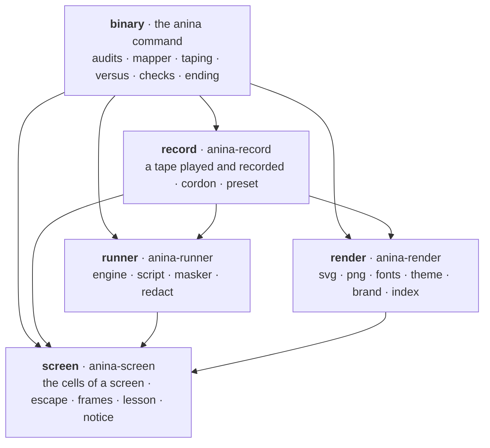
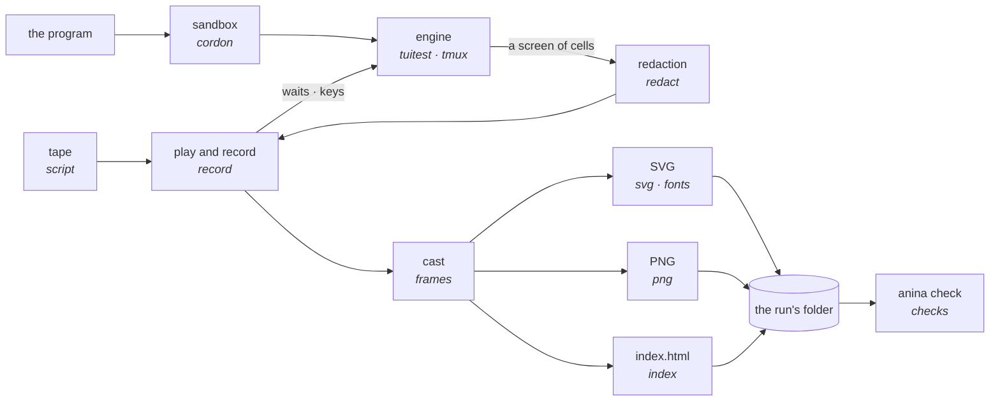

# Architecture

anina runs a program in a terminal it holds in memory, reads the screen cell by cell, and writes down what it saw: a cast, screenshots, an animated SVG, a report. This page shows how the parts fit. Each part links to the decision behind it in [`docs/adr/`](docs/adr).

## The crates

Five crates in [`rust/`](rust), one per layer. An arrow points at what a crate depends on, and nothing points up: a dependency the wrong way does not compile ([ADR-0013](docs/adr/0013-a-workspace-of-layered-crates.md)).

| crate | what it holds | decisions |
| --- | --- | --- |
| [`screen`](rust/screen) | The model everything else speaks: a `Screen` of cells with their colors, the ANSI parser (`escape`), a recording as distinct screens and the frames that point at them (`frames`), and `notice`, where a library says a line without printing it. | [0001](docs/adr/0001-read-the-screen-not-the-clock.md) |
| [`runner`](rust/runner) | The terminal a program runs in (`engine`: tui-test in process, tmux as the fallback), the tape language (`script`), the cells that change by themselves (`masker`), and redaction (`redact`, with the `Scope` of one command). | [0002](docs/adr/0002-an-in-process-terminal-with-tmux-as-fallback.md), [0004](docs/adr/0004-one-tape-language-that-reads-vhs.md), [0006](docs/adr/0006-isolate-every-run-and-redact-before-writing.md), [0008](docs/adr/0008-mask-what-changes-by-itself.md) |
| [`render`](rust/render) | A cast drawn as one looping SVG with an embedded font subset (`svg`, `fonts`), a screen as a PNG that carries its own text (`png`), the theme (`theme`, and `brand`, a theme from the program's own colors), and the HTML page of a run (`index`). | [0005](docs/adr/0005-animated-svg-with-an-embedded-font.md) |
| [`record`](rust/record) | A tape played against an engine and recorded; the sandbox a run happens in (`cordon`: a fresh HOME, and `sandbox-exec` or `bwrap` under `strict`); and presets (`preset`): a program's journey kept in [`demo/`](demo), prepared, played part by part, written to one folder. | [0006](docs/adr/0006-isolate-every-run-and-redact-before-writing.md), [0007](docs/adr/0007-nothing-about-one-program-in-the-core.md), [0009](docs/adr/0009-one-folder-per-run-with-stable-names.md), [0016](docs/adr/0016-put-back-only-what-a-play-changed.md) |
| [`binary`](rust/binary) | The command line, and the commands that are more than one call below: `audits` (one journey in many terminals, scored), `mapper` (`explore`), `taping` (`init`), `versus` (`compare`), `checks` (`check`), and `ending` (the exit codes). The only crate that parses flags or prints. | [0003](docs/adr/0003-a-single-rust-binary.md), [0014](docs/adr/0014-code-and-cli-speak-to-different-readers.md), [0015](docs/adr/0015-waits-that-hold-until-the-program-answered.md) |

The names follow a lexicon: a name anina coins is one word of its siblings' length, and a name the world gave (`tmux`, `svg`, `png`, `linux`) stays as given ([ADR-0010](docs/adr/0010-equal-length-siblings-and-a-shared-lexicon.md)). Where the code's word and the command's differ (`mapper` and `explore`, `cordon` and `--sandbox`), [`docs/TERMS.toml`](docs/TERMS.toml) holds both.

## The path of a run

What happens between `anina run helix` and the last line it prints.

1. **The tape.** A preset's part, or a file given to `record`, is parsed into steps: `Spawn`, `Type`, `Key`, `Wait`, `Snap`. anina's dialect and vhs's are one language ([ADR-0004](docs/adr/0004-one-tape-language-that-reads-vhs.md)).
2. **The sandbox.** The program starts with a HOME, a temp folder and an environment of its own. Under `--sandbox strict` it starts behind `sandbox-exec` or `bwrap`, and so does every shell line of the run ([ADR-0006](docs/adr/0006-isolate-every-run-and-redact-before-writing.md), [`SECURITY.md`](SECURITY.md)).
3. **The engine.** The program draws into a terminal anina holds in memory. A `Wait` holds until the screen shows the text, never for a length of time ([ADR-0001](docs/adr/0001-read-the-screen-not-the-clock.md), [ADR-0002](docs/adr/0002-an-in-process-terminal-with-tmux-as-fallback.md)).
4. **Redaction.** Every screen read from the engine is redacted before anything is made from it: a wait, a frame, a screenshot ([ADR-0006](docs/adr/0006-isolate-every-run-and-redact-before-writing.md)).
5. **The cast.** The screens that differ are kept once, with the frames that point at them in time. Cells that change by themselves, a clock or a spinner, are learned and left out when two screens are compared ([ADR-0008](docs/adr/0008-mask-what-changes-by-itself.md)).
6. **The renderers.** The cast becomes one looping SVG with its font inside, each `Snap` becomes a PNG that carries the text of its screen, and the run gets a page ([ADR-0005](docs/adr/0005-animated-svg-with-an-embedded-font.md)). All of it goes to one folder with names that do not change between runs ([ADR-0009](docs/adr/0009-one-folder-per-run-with-stable-names.md)).
7. **The check.** The command ends by reading what it wrote, screenshots included, for anything redaction missed, and fails if it finds something ([ADR-0006](docs/adr/0006-isolate-every-run-and-redact-before-writing.md)).

The other commands walk the same path and add one thing each:

- `audit` plays the journey once per terminal of a matrix (sizes, color depths, `NO_COLOR`, locale) and scores what it measured. With `--preset`, only what a play changed is put back between terminals ([ADR-0016](docs/adr/0016-put-back-only-what-a-play-changed.md)).
- `explore` has no tape: it reads the key hints on screen, tries them, and maps the screens it reaches.
- `init` writes the tape while a person uses the program, with waits that hold in the other terminals an audit tries ([ADR-0015](docs/adr/0015-waits-that-hold-until-the-program-answered.md)).
- `compare` reads two folders and says whether they are the same run, timing aside. anina runs it on its own output in every build ([ADR-0017](docs/adr/0017-a-reference-run-per-system-guards-what-anina-records.md)).

Nothing in the crates knows any one program: what is particular to helix or to glow lives in its preset ([ADR-0007](docs/adr/0007-nothing-about-one-program-in-the-core.md)).

## How a command ends

The crates below the binary return values and plain errors, and report through the `Notice` they are passed. The binary decides what is printed and with which code the command exits (`rust/binary/src/ending.rs`; the table is in the [README](README.md#commands)).

## How anina is built

Who writes the commits, how a change gets in and the gates it passes are in [`CONTRIBUTING.md`](CONTRIBUTING.md).
