# anina

**Drive, map, audit and animate any terminal app. No AI required.**

anina runs a terminal program in a real terminal and reads its screen the
way a person does: cell by cell, colors and all. On top of that it records
demos you can drop in a README, maps every screen of a TUI by itself, writes
test scripts while you use the program, and audits how it behaves across
terminals.

Think Playwright + Lighthouse + VHS, for terminal apps.

<p align="center"></p>

<sub>Recorded by `anina run urna`: a ratatui app with braille art, truecolor
and live animation, in a 425 KB self-contained SVG (48 KB gzipped).</sub>

## What it does

| Command | What you get |
| --- | --- |
| `anina run PRESET` | A whole journey (install, first use, ...) or some parts of it: screenshots, an animated SVG per part, an HTML page, and a report of every file the program wrote |
| `anina record TAPE` | Plays a script against a program; writes the recording and an animated SVG. Reads [vhs](https://github.com/charmbracelet/vhs) tapes too |
| `anina init -- CMD` | You use the program; anina writes the tape, with waits on the text that appeared after each key |
| `anina explore -- CMD` | Maps a TUI with no script: reads the key hints on screen, tries them, and builds a graph of every screen and key, with a Mermaid map and a tape to reach any screen |
| `anina audit TAPE` | Runs the same journey in many terminals (sizes, 16/256/truecolor, `NO_COLOR`, `LC_ALL=C`) and scores stability, responsiveness, contrast (WCAG), compatibility and terminal hygiene |
| `anina render CAST` | Re-renders a recording: theme, speed, light/dark chrome, poster PNG |
| `anina brand CAST` | A theme taken from the app's own colors |
| `anina export CAST` | asciicast v3, for the asciinema player, agg and asciinema.org |
| `anina doctor` | Checks that anina can drive a terminal here |

Every run is isolated (a fresh HOME and environment, optionally an OS sandbox)
and redacted before anything is written: your home path, user and host names,
git identity and token-shaped secrets never reach a screenshot.

## Install

```sh
cargo install --git https://github.com/brennercruvinel/anina
anina doctor
```

Needs Rust 1.90+. Optional: `tmux` (a second engine you can attach to and
watch), `sandbox-exec` (macOS) or `bwrap` (Linux) for `--sandbox strict`.
macOS and Linux.

## Quick start

```sh
anina presets                      # what ships: shell, astro, burn, urna
anina run shell                    # the smallest journey, no network
open anina-out/shell/index.html

anina init -o demo.tape -- htop    # use htop; ctrl+] stops; demo.tape replays it
anina record demo.tape             # -> anina-out/demo/demo.svg

anina explore -- htop              # graph.json, map.md, screens/*.png
anina audit demo.tape              # report.html with five scores
```

## Gallery

All recorded by the presets in [`presets/`](presets), from an empty sandbox.

| | |
| --- | --- |
| **create-astro**: inline prompts in Node, Houston included<br> | **burn**: a training dashboard with braille plots and a quit popup<br> |
| **urna setup**: an installer from an empty machine to its doctor checks<br> | **urna tui**: open, ask, read the cited answer<br> |

## Tapes

One step per line. anina's own dialect and vhs's both work:

```text
Set Cols 100
Set Rows 30
Set CleanEnv on
Set Env HOME=$SANDBOX/home PATH=/usr/bin:/bin
Spawn my-tui --flag                # no shell around it
Caption "1 · open a file"
Key 1
Wait "sections"                    # text or /regex/
Gone "opening "                    # a toast leaves
Type "how do citations work"
Key Enter Down*2 ctrl+q
Idle                               # until the screen stops changing
Snap 03-answer                     # a named screenshot
Poster                             # the still frame for viewers without animation

Type@50ms "echo hi"                # vhs style
Enter 2
Wait+Screen@10s /hi/
Screenshot shot.png
```

The full reference is at the top of [`src/tape/mod.rs`](src/tape/mod.rs).
A wait that fails says what was on screen and the closest text to what you
asked for, and saves that screen.

## Presets

A preset is a folder: `preset.toml` (requirements with install hints,
variables, sandbox mode, cached prepare steps, redaction rules, theme) and one
tape per part of the journey.

```sh
anina run burn                     # clone + build burn once (cached), then the training TUI
anina run urna --part tui          # only the explorer part
anina run ./my-preset --sandbox strict
```

The core never names a program: everything about a specific app lives in its
preset. See [`presets/`](presets) and [CONTRIBUTING.md](CONTRIBUTING.md).

## What the audit found on its first runs

- **urna**: writes truecolor even when the terminal does not announce it; its
  dimmest palette steps fall below WCAG contrast (key-hint footer at 3.6:1);
  the home screen changes its wording at 80x24, which breaks tapes that wait
  on that text.
- **burn**: killing training from the TUI exits with code 101 (a deliberate
  `panic!`).
- **macOS `ls -G`**: ignores `NO_COLOR`; its directory blue on black is 2.2:1.

## How it works

- **Engine.** Programs run in an in-process terminal emulator,
  [tui-test](https://github.com/microsoft/tui-test)'s (alacritty_terminal over
  a native pty). A full screen read takes about 0.15 ms, so anina can sample
  often, wait on stable screens and measure latency. tmux is a second engine
  behind the same trait.
- **Waits.** Every step waits on what the screen shows, never on the clock.
  Cells that change by themselves (spinners, clocks, animations) are learned
  and ignored when comparing screens.
- **SVG.** One looping SMIL timeline; each distinct row is drawn once and
  reused; braille is drawn as dots, block and box characters as shapes; an
  embedded subset of JetBrains Mono makes it look the same everywhere,
  including inside `` on GitHub. PNGs render the same SVG with resvg: no
  browser.

The reasons behind each choice are in [`docs/adr/`](docs/adr).

## Limits

- Mouse input is not scripted yet.
- Glyphs outside JetBrains Mono (CJK, emoji, some arrows) use the viewer's
  fonts.
- `explore` treats screens with the same key bar and most cells equal as one
  state; very slow transitions may be credited to the wrong key.
- Windows is untested.

## License

MIT. JetBrains Mono is under the SIL Open Font License (`assets/fonts/OFL.txt`).
